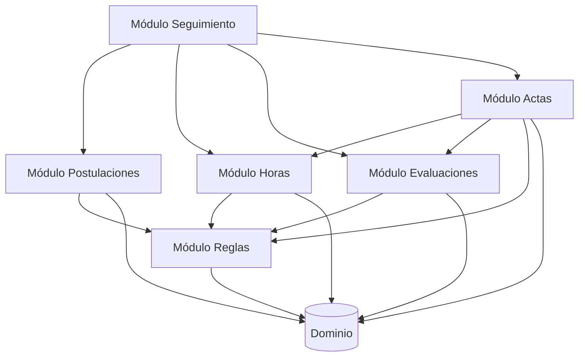

# Vista de desarrollo: componentes del backend

Para: programadores. Notación: C4 nivel 3, con las capas de Clean Architecture y una vista de usos sin ciclos.

## 1. Presentación principal

Diagrama: [../diagramas/03-desarrollo.puml](../diagramas/03-desarrollo.puml). El mismo código se ejecuta como API, como Procesador de tareas y como Comando de migración.

### Vista de usos (sin ciclos)

Reglas: Reglas no usa a ningún otro módulo de casos de uso; Seguimiento solo lee; **ningún ciclo** (un ciclo es deuda técnica arquitectónica y se detecta en el PR).

### Capas

| Capa | Contenido | Puede usar |
|---|---|---|
| `dominio/` | Entidades y reglas | Nada |
| `aplicacion/` | Módulos de casos de uso, puertos y política de autorización | `dominio/` |
| `infraestructura/` | Controlador REST, adaptadores (SIA, identidad, correo, PostgreSQL, documentos, PDF) | `aplicacion/` (implementa puertos) |

## 2. Catálogo de elementos

| Componente | Tipo | Responsabilidad | Depende de |
|---|---|---|---|
| Controlador REST | Adaptador de entrada | Traduce HTTP a casos de uso | Módulos, política de autorización |
| Política de autorización | Aplicación | Rol y pertenencia, negación por defecto | Dominio |
| Módulo Postulaciones | Casos de uso | [CU-01](../drivers.md#cu-01), [CU-02](../drivers.md#cu-02), [CU-03](../drivers.md#cu-03) | Reglas, puertos ConsultaAcademica y Repositorios |
| Módulo Horas | Casos de uso | [CU-04](../drivers.md#cu-04), [CU-05](../drivers.md#cu-05), [CU-06](../drivers.md#cu-06) | Reglas, puertos |
| Módulo Evaluaciones | Casos de uso | [CU-07](../drivers.md#cu-07), [CU-08](../drivers.md#cu-08) (enlaces y recordatorios) | Reglas, puertos Notificaciones y Repositorios |
| Módulo Actas | Casos de uso | [CU-09](../drivers.md#cu-09), [CU-10](../drivers.md#cu-10) | Horas, Evaluaciones, Reglas, puertos GeneradorPdf, Documentos, Bitacora |
| Módulo Reglas | Casos de uso | [CU-12](../drivers.md#cu-12) y evaluación de reglas | Dominio, puerto Repositorios |
| Módulo Seguimiento | Casos de uso | [CU-11](../drivers.md#cu-11), [CU-13](../drivers.md#cu-13), [CU-14](../drivers.md#cu-14) | Postulaciones, Horas, Evaluaciones, Actas (solo lectura) |
| Dominio | Entidades | Entidades y reglas del negocio | — |
| Puertos | Interfaces | Contratos hacia el exterior | Dominio |
| Adaptador SIA | Adaptador | Implementa ConsultaAcademica sobre REST | SIA (HTTPS) |
| Adaptador de identidad | Adaptador | Implementa Identidad con OIDC | Proveedor de identidad |
| Adaptador de correo | Adaptador | Implementa Notificaciones con SMTP | Servicio de correo |
| Adaptador PostgreSQL | Adaptador | Repositorios, tareas pendientes y bitácora | PostgreSQL (SQL) |
| Adaptador de documentos | Adaptador | Implementa Documentos | Almacenamiento institucional |
| Generador de PDF | Adaptador | Llena la plantilla del acta | Librería de PDF libre |

## 3. Justificación

- [EAC-01](../drivers.md#eac-01), [OB-05](../vision.md#ob-05) y [ADR-001](../adr/ADR-001-monolito-modular.md), [ADR-007](../adr/ADR-007-reglas-versionadas.md): un módulo por capacidad; un programa nuevo toca como máximo 2 módulos (Reglas y, si hay un requisito nuevo, Postulaciones).
- [RT-03](../drivers.md#rt-03) y [ADR-003](../adr/ADR-003-integraciones-outbox.md): el SIA queda aislado en un solo adaptador.
- [RT-04](../drivers.md#rt-04) y [ADR-002](../adr/ADR-002-plataforma-institucional.md): PostgreSQL aislado en un adaptador.
- [PA-02](../drivers.md#pa-02) y [ADR-005](../adr/ADR-005-autorizacion-por-roles.md): autorización centralizada.
- Regla de dependencia: los casos de uso declaran los puertos; los adaptadores los implementan.
- Cuatro personas y 16 semanas (restricción del curso): un módulo por caso de uso es abarcable.

## 4. Comportamiento

[CU-01](../drivers.md#cu-01) dentro del backend: Controlador → Módulo Postulaciones → puertos Repositorios/TareaPendiente → Adaptador PostgreSQL; el Procesador de tareas invoca el Adaptador SIA. Ver [ESC-01](../diagramas/secuencias/cu01-postularse.puml).

## 5. Vistas relacionadas

- [Procesos](02-procesos.md): es el interior de API y Procesador de tareas.
- [Lógica](01-logica.md): los módulos operan sobre las entidades del dominio.
